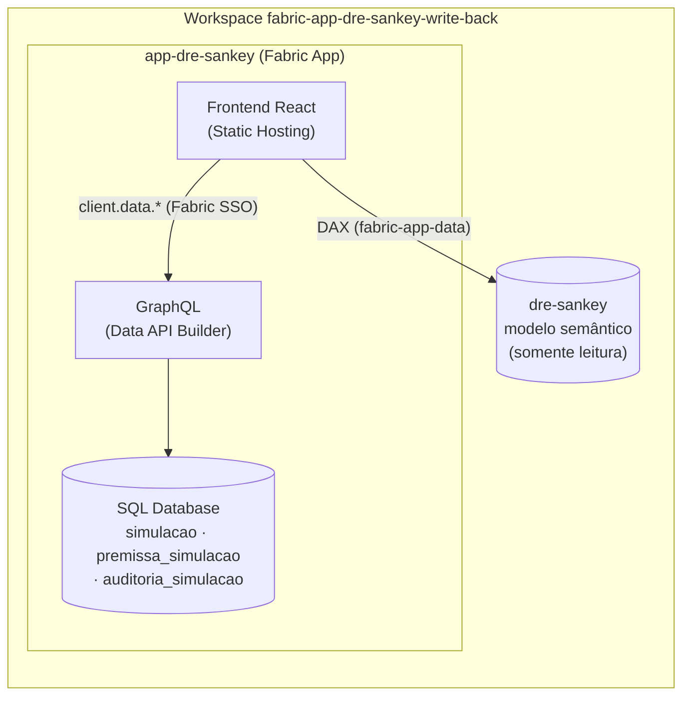
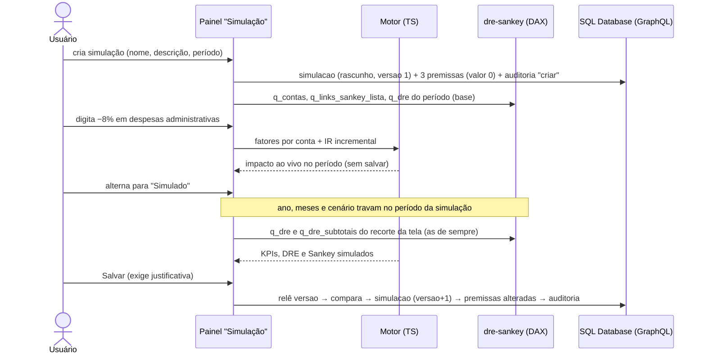
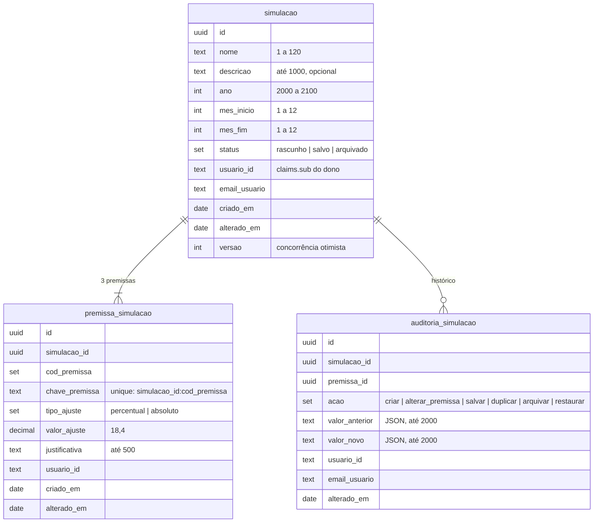

# Simulação de premissas e write-back

Evolução do `app-dre-sankey`: o usuário cria **simulações** com premissas sobre o realizado (receita líquida, custos e despesas administrativas), vê o impacto na hora em KPIs, DRE e Sankey e grava tudo no SQL Database do próprio app. O modelo semântico `dre-sankey` continua sendo a fonte oficial e somente leitura.

> "Simulação" e não "cenário": o modelo já tem `dim_cenario` (realizado e orçado).

## Arquitetura



| camada | arquivos |
|---|---|
| leitura (DAX) | `src/dados/consultas_dax.ts`: `q_dre` ganhou `dim_conta[natureza]` (mesmo grão); novas `q_contas` (plano de contas) e `q_links_sankey_lista` (os 33 links de `dim_link_sankey`, com `cod_conta`) |
| cálculo (TS puro) | `src/simulacao/mapa_premissas.ts`, `motor_simulacao.ts`, `cascata_sankey.ts`, `visao_simulada.ts`, `validacao_premissas.ts`, `textos_simulacao.ts` |
| escrita (GraphQL) | `src/simulacao/repositorio_simulacoes.ts` (CRUD, versão e auditoria) e `cliente_simulacoes.ts` (adaptador do `client.data`) |
| estado e UI | `src/estado/estado_simulacao.ts`; `src/componentes/painel_simulacao.tsx`, `controles_simulacao.tsx`, `lista_simulacoes.tsx`, `historico_simulacao.tsx`; modo Simulado em `pagina_principal.tsx`, `barra_filtros.tsx`, `cartao_kpi.tsx`, `tabela_dre.tsx` e `grafico_sankey.tsx` |
| entidades | `app-dre-sankey/rayfin/data/` (`simulacao.ts`, `premissa_simulacao.ts`, `auditoria_simulacao.ts`, `schema.ts`) e `rayfin/tsconfig.json` |

Nenhuma escrita toca o modelo nem `fato_lancamentos`: o repositório só conhece as três entidades do app.

## Fluxo



## Regras do motor (`src/simulacao/motor_simulacao.ts`)

| premissa | contas (`mapa_premissas.ts`) | total da categoria (base do ajuste absoluto) |
|---|---|---|
| `receita_liquida` | 5 `rec_*` + 2 `ded_*`, mesmo fator (a receita líquida varia exatamente o ajuste) | receita líquida (Σ `valor_dre`) |
| `custos` | 4 `cst_*` | Σ dos custos (positivo) |
| `despesas_administrativas` | `opx_pessoal_administrativo`, `opx_gerais_administrativas` | Σ das duas (positivo) |

1. **Plano de contas:** o mapa é validado contra `q_contas`. Conta ausente ou de custo com natureza diferente de despesa derruba a simulação com erro (`ErroMapaPremissas`).
2. **Base:** `q_dre` no período da simulação, todas as regiões, coluna `realizado`. `natureza` converte `valor_dre` ↔ `valor` sem adivinhar o sinal.
3. **Fator:** percentual → `p/100`; absoluto → `valor / total da categoria na base`. São premissas inválidas, com mensagem na UI e fator 0, nunca divisão por zero: total zero com ajuste absoluto, |fator| > 1 (a categoria trocaria de sinal), percentual fora de −100% a +100% e valor não numérico.
4. **Recorte:** o fator multiplica cada conta afetada do recorte da tela (a `q_dre` da tabela da DRE). É uniforme, então a soma dos recortes é o total, e regiões e filtragem cruzada continuam válidas.
5. **Subtotais:** mesma cascata da pasta `01_dre` (receita líquida → lucro bruto → EBITDA → EBIT → LAIR → lucro líquido); margens com divisão segura (`null` quando o denominador é zero).
6. **IR & CSLL incremental:** `ir_sim = max ( 0, ir_real + alíquota × ( lair_sim − lair_real ) )`, em gasto (positivo), com `alíquota = ir / lair` da base. Com LAIR da base ≤ 0 ou alíquota fora de [0, 1], a alíquota vale 0 (IR fixo) e o painel avisa. Sem variação de LAIR, o IR do realizado fica como está.
7. **Inalterados:** D&A, resultado financeiro, P&D, vendas e marketing, despesas não recorrentes e o operacional. As medidas `_aa` e as não aditivas (clientes ativos, headcount) não são simuladas.
8. **Sankey** (`cascata_sankey.ts`): porte da medida `sankey_valor` (saldos s0…s5, links de `prejuizo_liquido`, limiar 0,005) sobre os valores por conta já agregados do recorte. Link folha = valor da conta; subtotal e prejuízo = cascata. É a exceção da regra 5 do `CLAUDE.md`.

**Invariantes testados** (fixtures reais do modelo, `scripts/capturar_fixtures.mjs`):

- sem premissas, o simulado é idêntico ao realizado e ao modelo: subtotais contra `q_dre_subtotais` e cada link contra `q_sankey_links`, em mar/2025, abr/2025, abr/2025 só Sudeste e 2025;
- todo nó do Sankey simulado fecha (entrada = saída) com premissas de contenção, queda forte e alta de receita;
- exemplo ilustrativo: 1 mi − 600 mil − 250 mil = 150 mil → −8% adm. = 170 mil (+20 mil), tanto em % quanto em R$ (−20 mil).

## Entidades (`app-dre-sankey/rayfin/data/`)



| entidade | permissões (`authenticated`) |
|---|---|
| `simulacao` | create, read, update com `claims.sub = usuario_id`; sem delete (arquivar) |
| `premissa_simulacao` | idem; guarda o próprio `usuario_id` porque a policy não navega relações |
| `auditoria_simulacao` | create e read com `claims.sub = usuario_id` (append-only para o usuário) |

Os tamanhos e a nulidade dos campos são os do esquema aplicado no workspace em 08/11/2026. Mudá-los é migração destrutiva (`--force`) e só com autorização.

## Operações GraphQL

O app não escreve GraphQL à mão: usa o cliente gerado pelo Rayfin (`client.data.<entidade>`) em `repositorio_simulacoes.ts`. No Rayfin 1.36.2, consulta sem `.select([...])` e mutações devolvem só o `id`, então toda leitura seleciona todos os campos e todo registro criado é relido.

| operação | chamadas |
|---|---|
| listar | `simulacao.select([...]).where({ usuario_id: { eq } }).orderBy({ alterado_em: "desc" }).first(100).execute()` |
| abrir | `simulacao.select([...]).where({ id: { eq } })` + `premissa_simulacao.select([...]).where({ simulacao_id: { eq } })` (exige as 3) |
| criar | `simulacao.create` + 3× `premissa_simulacao.create({ simulacao: { id } })` + relê + auditoria `criar` |
| salvar | relê `versao` (diverge → conflito, nada é gravado) → `simulacao.update` (`versao + 1`) → `premissa_simulacao.update` por premissa alterada (+ auditoria `alterar_premissa`) → relê → auditoria `salvar` |
| duplicar | abrir + criar "Cópia de …" em rascunho com as mesmas premissas + auditoria `duplicar` (origem no `valor_anterior`) |
| arquivar / restaurar | relê `versao` → `simulacao.update` (status, `versao + 1`) → auditoria. Restaurar volta a `salvo` se as justificativas existem, senão a `rascunho` |
| histórico | `auditoria_simulacao.select([...]).where({ simulacao_id: { eq } }).orderBy({ alterado_em: "desc" }).first(100)` |

**Salvar** grava `status = salvo` e exige justificativa em toda premissa diferente de zero. **Salvar rascunho** aceita justificativa em branco. Simulação arquivada é só leitura.

## Experiência

- **Barra de filtros:** grupo "Visão" (Realizado | Simulado) e o atalho para o painel. No modo Simulado, ano, meses e cenário ficam travados no período da simulação (sobre o realizado), com o selo "Simulado · período · sobre o realizado". Regiões e filtragem cruzada continuam funcionando; uma seleção de meses fora do período é descartada.
- **Painel "Simulação"** (gaveta à direita; tela inteira no mobile):
  - *Premissas:* nome, descrição, período, as 3 premissas (%/R$, valor, base no período, equivalente em R$ ou % e justificativa) e o impacto ao vivo no período (receita líquida, EBITDA, lucro líquido e margem). Estados: salvando, salvo, erro de validação por campo, conflito de versão com "Recarregar" e alterações não salvas.
  - *Simulações salvas:* filtro por status (ativas, rascunho, salvo, arquivado); abrir, duplicar, arquivar e restaurar.
  - *Histórico:* a auditoria da simulação aberta.
- **Modo Simulado:**
  - KPIs: receita líquida, lucro bruto, EBITDA, lucro líquido e margem com variação vs realizado e o valor realizado abaixo, mais o cartão "Impacto no lucro líquido";
  - DRE: Realizado | Simulado | Δ | Δ%, com marcador tracejado nas contas alteradas;
  - Sankey: o mesmo `GraficoSankey`, com alternador no cabeçalho, nós alterados com contorno tracejado e dica "realizado → simulado (Δ, Δ%)".

  Cartões e tabela simulados ganham selo e contorno tracejado: a diferença não depende só da cor. Tendência e evolução mensal do nó continuam no realizado.

## Autenticação e autorização

- Mesma autenticação do app (Fabric SSO pelo `AuthGate`). O `usuario_id` gravado é `session.user.id` (de `useAuth()`), comparado pela policy com `claims.sub`. No deploy de 08/11/2026 eles bateram: criar e salvar funcionaram.
- O singleton `getRayfinClient()` do template continua sem tipo de schema (é o do login). Só o acesso a `data` é tipado, em `cliente_simulacoes.ts`. O front importa as entidades só como tipo, porque o `plugin-react-swc` não compila decoradores TC39.
- O RLS do modelo semântico **não** protege o SQL Database: a segurança das simulações vem das policies das entidades.
- Erros sem detalhes internos na UI (`mensagem_para_usuario`).

## Desenvolvimento e testes

```bash
cd app-dre-sankey
npm test          # motor, cascata, validação, repositório (cliente falso), visão simulada e painel
npm run lint
npm run build
node scripts/capturar_fixtures.mjs   # regrava as fixtures do modelo (só leitura; exige az login)
```

O cliente falso (`src/simulacao/cliente_dados_falso.ts`) imita o Rayfin e o banco: devolve só os campos selecionados, só o `id` nas mutações, aplica a policy por `claims.sub`, recusa update na auditoria, valida `@set` e `unique`. Com ele os testes cobrem criação, recuperação, justificativa, conflito de versão, duplicar/arquivar/restaurar, isolamento entre usuários e "nenhuma escrita fora das três entidades".

`npm run dev` provisiona um backend real (inclusive o SQL Database): só com autorização.

## Implantação

1. `rayfin/rayfin.yml` tem `services.data: { enabled: true, dialect: mssql }`. O `rayfin/tsconfig.json` compila as entidades para `rayfin/.temp/compiled`: foi copiado do template `data-app` da CLI, porque o `dataapp` não traz esse arquivo e sem ele o deploy falha com "No rayfin/.temp/compiled/data/*.js files found".
2. `npx rayfin up --workspace fabric-app-dre-sankey-write-back --item-name app-dre-sankey` provisiona o SQL Database (se preciso), aplica o esquema e publica o frontend. Nunca usar `--force` sem revisar.
3. `npx rayfin up status --workspace fabric-app-dre-sankey-write-back --item-name app-dre-sankey` e abrir o app no portal.
4. Conferir no SQL Database (query editor, só leitura) as linhas criadas e a auditoria.
5. Retirar do `rayfin.yml` a URL de hospedagem que o deploy acrescenta (não versionar).

## Limitações conhecidas (Rayfin 1.36.2)

- `@entity()` não aceita constraint composta: a unicidade simulação × premissa usa `chave_premissa` com `unique`.
- O update do Data API Builder é por chave primária, sem ETag nem update condicional: a checagem de `versao` tem uma pequena janela de corrida entre a releitura e a gravação.
- Functions rodam com a identidade do chamador (`ctx.getDataClient()`) e não blindam nada que o GraphQL direto não permita; por isso esta versão não usa functions. As regras de negócio (justificativa ao salvar, faixas de valor, ano do calendário, mapa de contas) são validadas no cliente, em módulo testado; o banco garante tipos, `@set`, faixas, `unique`, chave estrangeira e não nulo.
- A auditoria é gravada pelo app: o banco impede alterar ou apagar linhas, mas não garante que toda ação gere uma.
- Uma consulta devolve uma página (100 linhas): a lista e o histórico mostram até 100 itens.
- Tendência e evolução mensal do nó continuam no realizado no modo Simulado.
- Falta provar com uma segunda conta, no portal, que um usuário não lê nem altera as simulações de outro (o teste com o cliente falso cobre a regra, não o backend).
