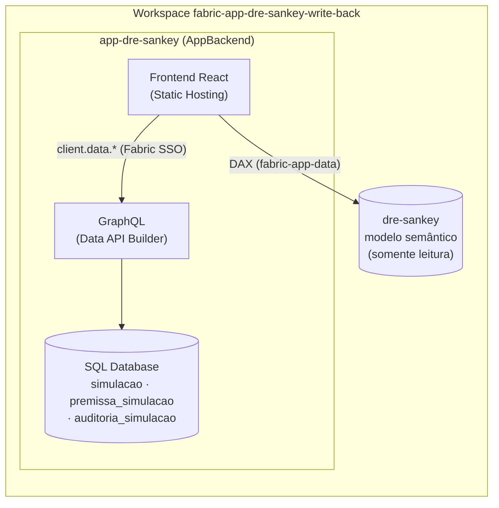
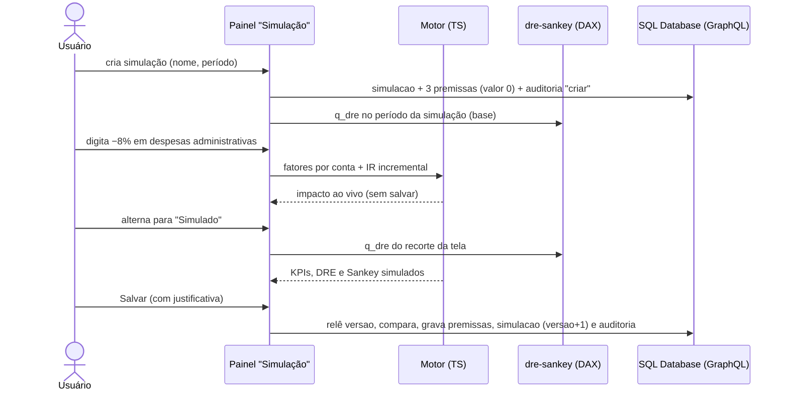
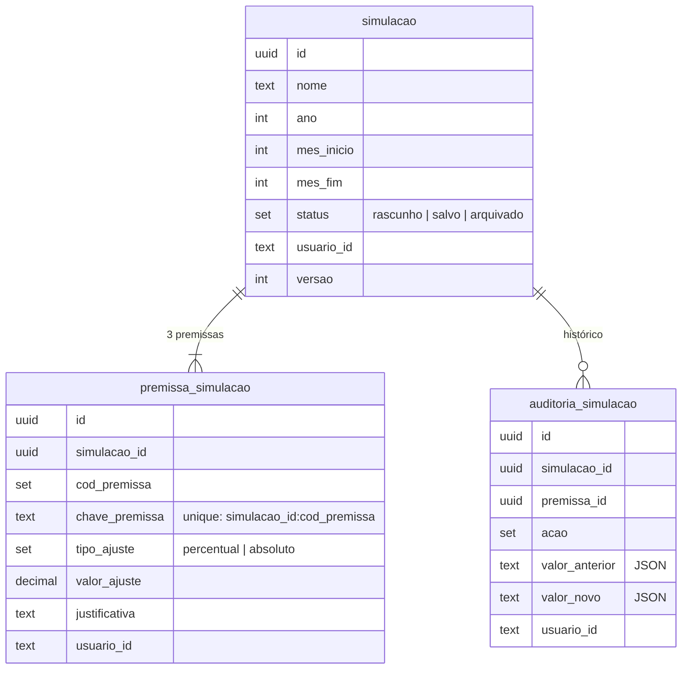

# Simulação de premissas e write-back

Evolução do `app-dre-sankey`: o usuário cria **simulações** com premissas sobre o realizado (receita líquida, custos e despesas administrativas), vê o impacto na hora em KPIs, DRE e Sankey e grava tudo no SQL Database do próprio app. O modelo semântico `dre-sankey` continua sendo a fonte oficial e somente leitura.

> "Simulação" e não "cenário": o modelo já tem `dim_cenario` (realizado e orçado).

## Arquitetura



- **Leitura:** as consultas DAX de sempre (`src/dados/consultas_dax.ts`), mais `q_sankey_links_dim` (links possíveis do Sankey) e a coluna `natureza` em `q_dre`.
- **Cálculo:** motor TypeScript puro em `src/simulacao/`, sobre as contas devolvidas pelo modelo.
- **Escrita:** só nas três entidades de `app-dre-sankey/rayfin/data/`, pelo cliente tipado do Rayfin. Nenhuma escrita no modelo.

## Fluxo



## Regras do motor (`src/simulacao/motor_simulacao.ts`)

| premissa | contas | base do ajuste absoluto |
|---|---|---|
| `receita_liquida` | 5 `rec_*` + 2 `ded_*` (mesmo fator: a receita líquida varia exatamente o ajuste) | receita líquida |
| `custos` | 4 `cst_*` | soma dos custos |
| `despesas_administrativas` | `opx_pessoal_administrativo`, `opx_gerais_administrativas` | soma das duas |

1. **Base:** `q_dre` no período da simulação, todas as regiões, realizado.
2. **Fator:** percentual → `p/100`; absoluto → `valor / total da categoria na base`. Total zero com absoluto, fator abaixo de −100% ou valor não numérico viram erro da premissa (nunca divisão por zero).
3. **Recorte:** o fator multiplica cada conta do recorte da tela (`q_dre` com os filtros atuais). É uniforme, então a soma dos recortes é o total e regiões e filtragem cruzada continuam válidas.
4. **Subtotais:** mesma cascata da pasta `01_dre` do modelo; margens com divisão segura.
5. **IR & CSLL incremental:** `ir_sim = ir_real + alíquota × (lair_sim − lair_real)`, sem ficar negativo quando o realizado não era. `alíquota = ir / lair` da base; com LAIR da base ≤ 0 ou alíquota fora de [0, 1], o IR fica fixo e o painel avisa.
6. **Inalterados:** D&A, resultado financeiro, despesas não recorrentes, P&D, vendas e marketing, operacional. As medidas `_aa` e as não aditivas não são simuladas.
7. **Sankey** (`cascata_sankey.ts`): porte da medida `sankey_valor` sobre os valores já agregados do recorte (regra 5 do `CLAUDE.md`).

**Invariante testado:** sem premissas, o simulado é idêntico ao realizado e ao modelo: subtotais contra `q_dre_subtotais` e cada link contra `q_sankey_links` (mar/2025, abr/2025, abr/2025 só Sudeste e 2025).

## Entidades (`app-dre-sankey/rayfin/data/`)



| entidade | permissões (`authenticated`) |
|---|---|
| `simulacao` | create, read, update com `claims.sub = usuario_id`; sem delete (arquivar) |
| `premissa_simulacao` | idem |
| `auditoria_simulacao` | create e read com `claims.sub = usuario_id` (append-only para o usuário) |

## Operações GraphQL

O app não escreve GraphQL à mão: usa o cliente gerado pelo Rayfin (`client.data.<entidade>`), em `src/simulacao/repositorio_simulacoes.ts`:

| operação | chamadas |
|---|---|
| listar | `simulacao.findMany({ usuario_id: { eq } })` |
| abrir | `simulacao.findById(id)` + `premissa_simulacao.findMany({ simulacao_id: { eq } })` |
| criar | `simulacao.create` + 3× `premissa_simulacao.create` + `auditoria_simulacao.create` |
| salvar | `abrir` (relê `versao`) → `premissa_simulacao.update` por premissa alterada → `simulacao.update` (`versao + 1`) → auditoria |
| duplicar | `abrir` + `criar` com as mesmas premissas + auditoria `duplicar` |
| arquivar / restaurar | `abrir` (relê `versao`) + `simulacao.update` (status) + auditoria |
| histórico | `auditoria_simulacao.findMany({ simulacao_id: { eq } })` |

## Autenticação e autorização

- Mesma autenticação do app (Fabric SSO pelo `AuthGate`). O `usuario_id` gravado é `session.user.id`, comparado pela policy com `claims.sub`.
- O RLS do modelo semântico **não** protege o SQL Database: a segurança das simulações vem das policies das entidades e é testada à parte.
- O repositório também confere o dono ao abrir (não depende só da policy).

## Desenvolvimento e testes

```bash
cd app-dre-sankey
npm test          # motor, cascata, validação, repositório (cliente falso) e painel
npm run lint
npm run build
node scripts/capturar_fixtures.mjs   # regrava as fixtures do modelo (az login)
```

`npm run dev` provisiona um backend real (inclusive o SQL Database): só com autorização.

## Implantação

1. `rayfin/rayfin.yml` já tem `services.data: { enabled: true, dialect: mssql }`, e `rayfin/tsconfig.json` compila as entidades para `rayfin/.temp/compiled` (o template `dataapp` não traz esse arquivo; ele foi copiado do template `data-app` da CLI).
2. `npx rayfin up --workspace fabric-app-dre-sankey-write-back --item-name app-dre-sankey` provisiona o SQL Database, aplica o esquema das entidades e publica o frontend.
3. `npx rayfin up status ...` e abrir o app no portal.
4. Conferir no SQL Database (query editor, só leitura) as linhas criadas e a auditoria.
5. Não versionar a URL de hospedagem que o deploy acrescenta ao `rayfin.yml`.

## Limitações conhecidas (Rayfin 1.36.2)

- `@entity()` não aceita constraint composta: a unicidade simulação × premissa usa `chave_premissa` com `unique`.
- O update do Data API Builder é por chave primária, sem ETag nem update condicional: a checagem de `versao` tem uma pequena janela de corrida.
- Functions rodam com a identidade do chamador e não blindam nada além do GraphQL direto; por isso não há functions. As regras de negócio (justificativa obrigatória ao salvar, faixas de valor, ano do domínio) são validadas no cliente; o banco garante tipos, valores fechados, faixas, unicidade e chaves.
- A auditoria é gravada pelo app: o banco impede alterar ou apagar linhas, mas não garante que toda ação gere uma.
- Consultas sem `.select([...])` e o `findById` devolvem só o `id`: o repositório sempre lista os campos e relê o registro depois de criar. Uma consulta devolve uma página (100 linhas): a lista e o histórico mostram até 100 itens.
- Tendência e evolução mensal do nó continuam no realizado no modo simulado.
- A ser confirmado no primeiro deploy: que `session.user.id` é o `claims.sub` usado pela policy e que a policy de `create` é aplicada pelo DAB em MSSQL.
